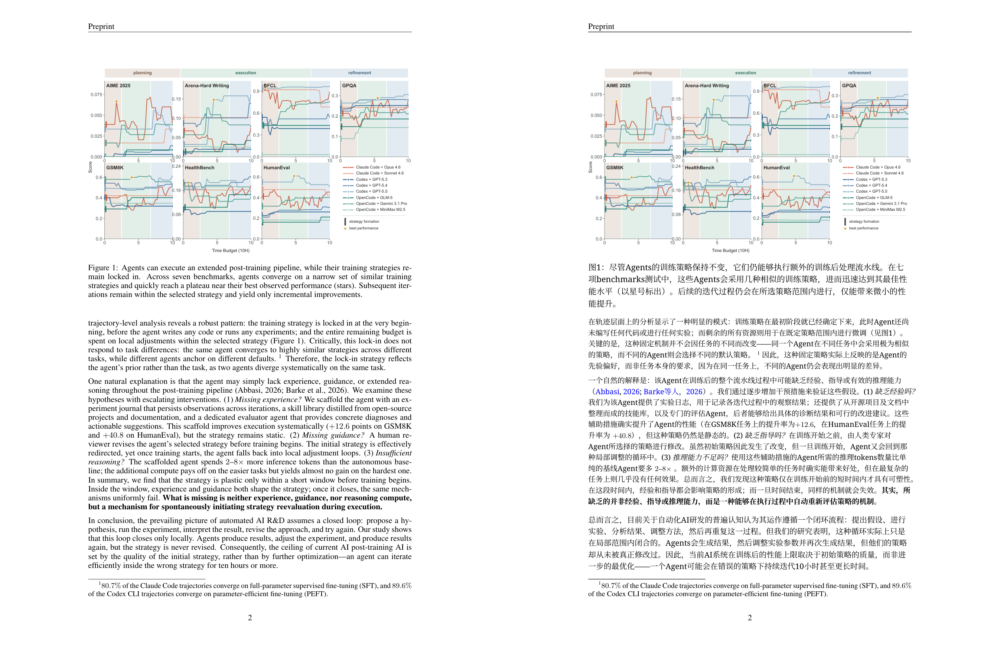

# Local Translator

基于开源的BabelDOC和LaTeXTrans配置的面向学术论文的本地翻译工具。支持 PDF 与 LaTeX 两种输入格式。

[](LICENSE)
[-lightgrey)](#安装)
[](https://github.com/funstory-ai/BabelDOC)



---

## 功能

- **PDF 与 LaTeX 源码支持** — 从学术论文的 PDF 文件或 LaTeX 源码翻译。
- **保留版式** — 公式、表格、插图、算法块从源文件原样搬回，行距与字号按需微调，不重排整页
- **选择性翻译** — 可选择文章中的图表等对象是否需要翻译。PDF 与 LaTeX 共用同一组开关
- **超链接还原** — 引用、交叉引用与网址在译文中复现
- **双语阅读器** — 内置阅读器，双语对照与纯译文均可打开
- **术语库与词典** — 随程序发布的可编辑术语库和基于 ECDICT 的离线英汉词典
- **三种后端** — 兼容本地模型、云端 API、或混合模式三种翻译后端配置

---

## 安装

### 下载安装（推荐）

在 [Releases](../../releases) 页面下载 `.dmg`，将「本地翻译」拖入「应用程序」。本程序未经 Apple 签名，需要在「隐私与安全性」中提供权限

带 `-tex` 的安装包内置 Tectonic，可直接翻译 LaTeX 源码；不带者需在设置中指定本机 `xelatex` 路径。

安装包不含模型权重，一份权重可供后续所有版本使用。首次打开需要下载推理程序、模型权重与阅读器组件，支持断点续传；之后完全离线可用。

### 从源码运行

```bash
git clone https://github.com/CanhuiLiPhy/LocalTranslator local-translator && cd local-translator && bash scripts/install.sh
```

安装脚本包含环境检查、依赖安装、权重与阅读器下载及配置向导。

<details>
<summary>手动安装</summary>

```bash
uv sync --extra native            # 依赖（native 提供桌面窗口，可省略）
uv run localtrans init            # 配置向导
uv run localtrans setup           # 下载模型权重
uv run localtrans setup-reader    # 下载 pdf.js 阅读器组件
uv run localtrans glossary seed   # 术语库种子（可选）
```

启动：`uv run localtrans serve`（浏览器界面）或 `uv run localtrans app`（桌面窗口）。

</details>

### 版本

为适配不同配置电脑，本项目提供三个不同版本，用户可以自行更换本地模型翻译后端

|          | 轻量版 `lite` | 本地轻量版 `mini`    | 完整版 `full`      |
| -------- | ------------- | -------------------- | ------------------ |
| 本地模型 | 无            | Hy-MT2 1.8B (Q4_K_M) | Hy-MT2 7B (Q6_K)   |
| 翻译后端 | 云端 API      | 本地 / 云端 / 混合   | 本地 / 云端 / 混合 |
| 需要下载 | 0             | 约 1.5 GB            | 约 7 GB            |
| 建议内存 | 8 GB          | 8 GB                 | 16 GB              |
| 离线可用 | 否            | 是                   | 是                 |

### 配置

首次运行依次询问翻译后端、语言与云端 API 端点，之后均在设置页修改。设置页分为：语言设置、输出设置与字体、选择性翻译、API 设置（含累计用量）、文件路径、LaTeX 引擎与字体，以及开发者选项（本地模型参数、翻译缓存、术语库、LaTeX 配置）。

- **LaTeX** — 显示当前使用的 TeX 引擎；未内置 Tectonic 时在此填写本机 `xelatex` 路径。
- **文件路径** — 译文保存位置与模型权重挂载位置在此设置，改动后重启生效，已有权重可直接指向其所在目录，不必重新下载。
- **API key** — 只存入系统钥匙串，不写入配置文件、日志或版本库。读取顺序为环境变量 `LOCALTRANS_API_KEY_<账户名>` → `~/.keys/<账户名>.env` → 钥匙串。仓库不包含任何默认端点，未配置时不启用云端后端。

---

## 代码来源

本项目PDF 翻译管线基于 [BabelDOC](https://github.com/funstory-ai/BabelDOC) 项目，针对原项目在本地配置时的漏洞做了若干调整和补丁，实现了：

- **本地化适配** — 本地推理服务（llama.cpp + Hy-MT2）、本地/云端混合调度、术语库、双语阅读器、任务队列与图形界面
- **版式与翻译修复** — 超链接还原、选择性翻译、图表与公式区块原样保留、图表内文字翻译、跨页断句重划
- **LaTeX 源码翻译功能** — 基于 [LaTeXTrans](https://github.com/NiuTrans/LaTeXTrans)的方案实现，接入本项目的翻译器与术语库，补充译文校验、前言改写与双语产物编排

## 许可证

**AGPL-3.0-or-later。** 

注意：内置术语库中源自机器之心「人工智能术语库」的条目按 **CC BY-NC-SA 4.0** 提供，商业使用前须删除（按 `source` 列可批量筛除）；本地模型权重按腾讯混元社区许可分发，授权地域不含欧盟、英国与韩国。详见 [THIRD_PARTY_NOTICES.md](THIRD_PARTY_NOTICES.md)，版权声明见 [NOTICE](NOTICE)，许可证全文见 [LICENSE](LICENSE)。

## 致谢

本项目使用的开源框架和项目如下：

- [BabelDOC](https://github.com/funstory-ai/BabelDOC) — 本项目PDF解析管线的来源
- [PDFMathTranslate](https://github.com/Byaidu/PDFMathTranslate) 
- [LaTeXTrans](https://github.com/NiuTrans/LaTeXTrans) 
- [PyMuPDF](https://github.com/pymupdf/PyMuPDF) — 版式修复与还原插件
- [PaddleOCR](https://github.com/PaddlePaddle/PaddleOCR) — 本项目的默认OCR引擎
- [Hunyuan MT / Hy-MT2](https://github.com/Tencent-Hunyuan/HY-MT) — 本项目的默认本地翻译模型
- [llama.cpp](https://github.com/ggml-org/llama.cpp) 
- [NiceGUI](https://github.com/zauberzeug/nicegui) 
- [ECDICT](https://github.com/skywind3000/ECDICT) 
- [机器之心 · 人工智能术语库](https://github.com/jiqizhixin/Artificial-Intelligence-Terminology-Database)
- [汇文仿宋](https://zhuanlan.zhihu.com/p/12669052378)  
